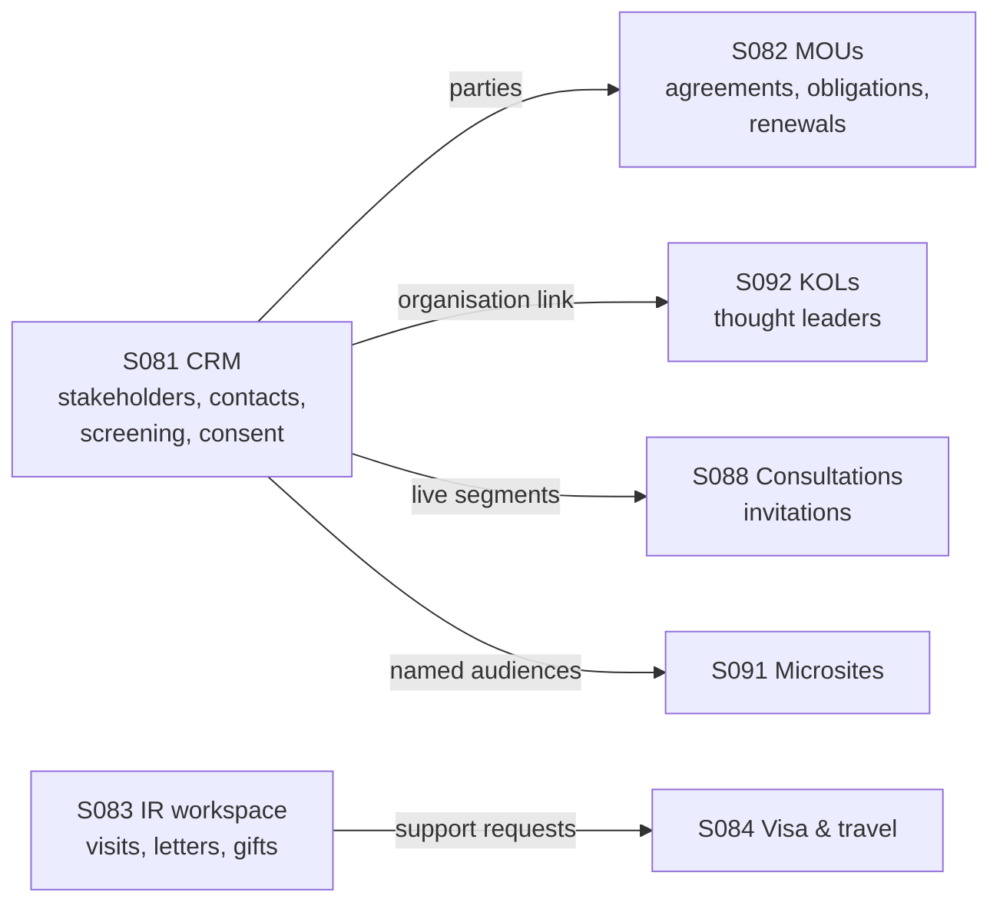

# CCP Digital Workspace: system overview and workflows

This document explains what the system is for, what each module does, and how each workflow should
behave from start to finish. It is written for anyone joining the project: developers, testers,
product owners and CCP staff. For setup and commands, see [README.md](README.md).

Everything below matches the frontend code as of September 2026. Where the code does not yet do what
the specification intends, the gap is listed in
[Open questions and known gaps](#open-questions-and-known-gaps) rather than described as working.

## Contents

- [What the system is](#what-the-system-is)
- [The modules at a glance](#the-modules-at-a-glance)
- [How the modules work together](#how-the-modules-work-together)
- [Rules that apply everywhere](#rules-that-apply-everywhere)
- [S081 Stakeholder / Partner CRM](#s081-stakeholder--partner-crm)
- [S082 MOU & Partnership Lifecycle Tracker](#s082-mou--partnership-lifecycle-tracker)
- [S092 KOL & Thought-Leader Tracker](#s092-kol--thought-leader-tracker)
- [S088 Public Survey / Consultation Platform](#s088-public-survey--consultation-platform)
- [S091 Donor / Annual-Report Microsite Builder](#s091-donor--annual-report-microsite-builder)
- [S083 International Relations & Protocols Workspace](#s083-international-relations--protocols-workspace)
- [S084 Visa & Travel Authorisation](#s084-visa--travel-authorisation)
- [Roles and what they can do](#roles-and-what-they-can-do)
- [External systems referenced](#external-systems-referenced)
- [Open questions and known gaps](#open-questions-and-known-gaps)

---

## What the system is

**CLET**, the Council for Legal Education and Training, is Ghana's national body for legal
education. It accredits law faculties and programmes, runs the National Bar Examination and keeps
the Roll of Lawyers.

CLET's digital estate has 12 clusters. This repository covers part of **Cluster 6 (C6):
Communications, Brand & Stakeholder Engagement**. The **CCP Directorate** (Communications &
Partnerships) owns C6. DTI, the Digital Transformation & Innovation Directorate, is the technical
owner. The CCP has three units that use this system:

- **Strategic Partnerships**: stakeholders, MOUs, consultations, donor microsites and thought
  leaders.
- **International Relations & Protocols**: foreign visits, delegations, diplomatic letters, gifts,
  visas and travel.
- **Media & Public Relations**: not built here; its systems appear only as integrations.

All the modules together form the **CCP Digital Workspace**: separate web apps that share one
sign-in, one look and an app switcher.

### Three principles run through every module

1. **Reference, don't replicate.** Each kind of record has one owning system. For example:
   - Students live in S027, staff in S140 and alumni in S034.
   - Documents live in S003 and legal contracts in S136.

   Other modules store only a reference (an ID or a reference number). They never keep a second
   copy.

2. **Controlled workflows.** Records move through defined states. A move that breaks a rule is
   refused with a reason. A module never guesses or skips a step.
3. **Accountability.** Every change records who made it and when, for the S204 audit trail.
   - Approvals follow a "four-eyes" rule where the specification requires one: the person who
     submits something cannot also approve it.
   - Official messages go out through S074, the Comms System.

## The modules at a glance

| System | Module                                        | Used by                                  | App (dev URL)                                       |
| ------ | --------------------------------------------- | ---------------------------------------- | --------------------------------------------------- |
| S081   | Stakeholder / Partner CRM                     | Strategic Partnerships                   | `apps/partner-portal` (http://localhost:5175)       |
| S082   | MOU & Partnership Lifecycle Tracker           | Strategic Partnerships, Registrar        | `apps/partner-portal`                               |
| S092   | KOL & Thought-Leader Tracker                  | Strategic Partnerships                   | `apps/partner-portal` under `/kol`                  |
| S088   | Public Survey / Consultation Platform         | Strategic Partnerships, the public       | `apps/consultation-portal` (http://localhost:5176)  |
| S084   | Visa & Travel Authorisation                   | International Relations, staff, students | `apps/travel-authorisation` (http://localhost:5177) |
| S091   | Donor / Annual-Report Microsite Builder       | Strategic Partnerships, RMF, donors      | `apps/donor-microsites` (http://localhost:5178)     |
| S083   | International Relations & Protocols Workspace | International Relations & Protocols      | `apps/ir-workspace` (http://localhost:5179)         |

**Where the modules live:**

- S081, S082 and S092 share one app, the **Partnerships Portal**, because they share stakeholder
  data. Its sidebar has four groups: Stakeholders, MOUs & partnerships, Thought leaders and
  Insights.
- S088 and S091 each have a staff area under `/admin` and a public website at `/`, which needs no
  account.
- The backend for every module is the separate `All-partner-cm-bacnkend` repository (FastAPI,
  PostgreSQL, Celery).

## How the modules work together



**A typical partnership journey:**

1. **Onboard the partner in S081.** The organisation record is created once. Duplicate checks stop a
   second copy.
2. **Screen it.** Donors, embassies and international bodies must clear S203 sanctions screening
   before anyone can log engagement with them.
3. **Build the relationship.** Staff log meetings, calls and events against the organisation and
   move it through the pipeline stages (Prospect, Engaged, Negotiation, MOU, Dormant).
4. **Formalise it in S082.** An agreement is drafted against the S081 organisation. It then goes
   through legal review in S136 and signature, where the signed copy is filed in S003. After that it
   is activated, its obligations are tracked, and it is renewed or terminated.
5. **Reach people.** S081 segments feed the S075 newsletter and S088 consultation invitations. Only
   consenting, screened and active contacts are ever included.
6. **Show impact.** Key opinion leaders (KOLs) are tracked in S092, and S091 publishes donor and
   annual-report microsites.

**A typical international visit:**

1. The visit is registered in S083, approved by a second person and then scheduled.
2. Protocol tasks are completed, and the visit takes place.
3. Diplomatic letters and gifts are recorded.
4. Support requests go out to other teams. For example, a visa-support request goes to S084.
5. The visit is closed once its minutes and mandatory follow-ups are done.

## Rules that apply everywhere

- **Signing in.** Staff sign in with email and password. The session is held in a secure, HTTP-only,
  same-origin cookie, and the browser never stores tokens. In production all apps share one origin,
  so signing in once works in every app. The app switcher in the header moves between them.
- **Roles.** Each user has one role, and each module maps roles to the actions they allow. A button
  the role cannot use stays visible but is disabled, and it explains why. The backend repeats every
  check, so the disabled button is only a convenience. See
  [Roles and what they can do](#roles-and-what-they-can-do).
- **Refusals.** A change that breaks a rule is refused with a readable message. The backend returns
  `409` for a state conflict or a stale edit, and `422` for invalid input. The error body is
  `{ code, message, fieldErrors, correlationId }`.
- **Audit.** Every change and every export is recorded with the actor, the time, and the values
  before and after (S204).
- **Notifications.** Official email and messages are sent through S074. A module records the S074
  reference and delivery status, and a failed delivery can be retried.
- **Exports.** Lists offer CSV, and several modules also offer Excel workbooks or a print-to-PDF
  view. Exports need the `export` permission. Public-facing exports never include personal data.
- **Two data modes.** Each app runs in one of two modes:
  - **`mock`**: seeded in-memory data that follows the same rules as the backend. It is useful for
    demos and frontend work.
  - **`api`**: real data from the backend.

  Production builds refuse mock mode. See [README.md](README.md#authentication-and-data-modes).

---

## S081 Stakeholder / Partner CRM

**Purpose:** S081 is the single authoritative register of CLET's **external organisations**:
universities, the judiciary, professional bodies, government, donors, embassies, international
bodies, media and peer institutions. It also holds each organisation's contacts, engagement history,
screening and consent position, and audience segments.

**Screens:**

| Screen                             | Route                |
| ---------------------------------- | -------------------- |
| Overview dashboard                 | `/`                  |
| Stakeholder register               | `/stakeholders`      |
| Add stakeholder                    | `/stakeholders/new`  |
| Stakeholder 360 profile            | `/stakeholders/:id`  |
| Compliance (screening and consent) | `/compliance`        |
| Audience segments                  | `/segments`          |
| Create a segment                   | `/segments/new`      |
| Edit a segment                     | `/segments/:id/edit` |
| Reports                            | `/reports`           |

### Workflow: add a stakeholder

1. **Fill in the record.** Required fields are the organisation name, relationship owner and
   location. Category, short name, website, health, pipeline stage and summary are optional or have
   defaults.
   - A blank short name is built from the name's initials.
   - A new record starts with status **Active**.
2. **Boundary check.** S081 holds organisations, not people, so the record is refused if it looks
   like a student, staff or alumni record. It is refused when:
   - the website is an internal CLET or GSL domain, or is an email address;
   - the name starts with a personal title such as Mr, Dr or Prof;
   - it contains a student or staff ID number;
   - it names a population (students, staff, alumni) without naming an organisation. For example,
     "Law Students' Association" is allowed.
3. **Duplicate check.** A match on the normalised name, or on the website, raises "Potential
   duplicate found".
   - The user can open the existing record, or choose **Create anyway**.
   - Create anyway requires a written reason, which is kept for the audit trail.
   - Editing a record into a duplicate is refused outright.
4. The record is created and the profile opens.

### Workflow: contacts, screening and consent

- **Adding a contact.**
  - A contact needs a name and a valid email.
  - An email may exist only once in the whole register, and a name only once per organisation.
- **S203 sanctions screening.**
  - Contacts in the **Donor**, **Embassy** and **International body** categories are marked
    "regulated" and start in **Pending** screening.
  - Other contacts start as **Not required**, but can be marked regulated by hand.
  - Once screening has been requested it cannot be switched off. Only an S203 decision changes it.
- **Recording a decision** (Compliance page, or the contact card). The decision is one of three:
  - **Cleared**: engagement may proceed.
  - **Review required**: engagement stays blocked. Notes are required.
  - **Rejected**: engagement stays blocked. Notes and an S203 case reference (`S203-YYYY-NNN`) are
    required.

  The reviewer and time are taken from the signed-in user and the clock, and cannot be edited.

- **What screening blocks.** While any active contact is Pending, Review required or Rejected:
  - the organisation shows **Screening pending**;
  - nobody can log engagement with it;
  - it cannot be a party to an S082 agreement;
  - the blocked contacts are left out of every segment.

  A Rejected contact never clears. The block is lifted only by deactivating that contact.

- **S188 consent.** Each contact is Consented, Withdrawn, Expired or Not recorded.
  - Consented and Withdrawn must record a date (not in the future) and a channel: form, email, in
    person, letter or phone.
  - Only **Consented** counts as permission to send marketing or consultation messages.
- **Deactivate and reactivate.** Deactivating keeps the contact for the record but removes it from
  segments and from screening holds. Reactivating re-applies its screening status.

### Workflow: log engagement

**Fields:** type (Meeting, Call, Email, Correspondence, Event, Campaign or MOU), title, summary and
date. The date defaults to today and cannot be in the future.

**When it is refused:**

- the user's role lacks `engage`;
- screening is blocking;
- the organisation is **Inactive**.

**The timeline** shows the newest entries first and can be filtered by type and by source.

### Workflow: live audience segments

A segment is a saved **rule**, not a saved list.

- **Rule criteria:** categories, relationship statuses, relationship owners, and "consented contacts
  only". An empty list means "any".
- **Resolved every time it is used.** Membership is worked out again from the live register. The
  form shows a live count of matching contacts before saving.
- **Always excluded**, whatever the rule says:
  - inactive organisations and inactive contacts;
  - contacts whose screening is Pending, Review required or Rejected;
  - contacts who withdrew consent.
- **Who can use it.** A segment must name at least one consumer: **S075 Newsletter** or **S088
  Consultations**. Those systems resolve the segment at send time, and contact records are never
  copied.
- **Consent for marketing.** Marketing sends through S075 should use "consented contacts only".

### Workflow: bulk import

1. Upload a spreadsheet of organisations. Contacts are not imported.
2. Rows are skipped, with a reason, when they:
   - miss a required field;
   - fail the boundary check;
   - use an unknown category;
   - duplicate an existing record;
   - repeat an earlier row in the file.
3. Accepted rows are created as Active, Healthy and Prospect.
4. A review list shows every skipped row and offers them as a CSV download.

### Reporting

- **Dashboard:** active stakeholders, healthy relationships, screening pending, active MOUs, a
  pipeline matrix and priority follow-ups.
- **Reports page:**
  - an S081 Excel workbook with Stakeholders, Contacts, Engagements, Segments and Pipeline sheets;
  - a relationship CSV;
  - engagement volume by month;
  - segment composition;
  - S082 renewal and obligation figures;
  - a print/PDF view.

---

## S082 MOU & Partnership Lifecycle Tracker

**Purpose:** S082 tracks every formal agreement from draft to expiry or termination. That covers
MOUs, partnership agreements and cooperation frameworks, with their obligations, value reviews,
renewals and alerts.

**Ownership:**

- S082 stores the S081 organisation IDs of the parties. It never stores its own copy of an
  organisation.
- The legal contract stays in **S136**. Signed documents and evidence stay in **S003**. S082 keeps
  only their reference numbers.

**Screens:**

| Screen                    | Route                       |
| ------------------------- | --------------------------- |
| Agreement portfolio       | `/partnerships`             |
| Create MOU or partnership | `/partnerships/new`         |
| Agreement detail          | `/partnerships/:id`         |
| Obligations workspace     | `/partnerships/obligations` |
| Milestone calendar        | `/partnerships/calendar`    |

### Agreement lifecycle

```text
DRAFT → LEGAL_REVIEW → SIGNATURE_PENDING → ACTIVE → RENEWAL_DUE ─┐
                                              │                   ├─ renew → ACTIVE
                                              └────→ EXPIRED ─────┘
                           ACTIVE / RENEWAL_DUE / EXPIRED → TERMINATED
```

| Step                                        | Button                  | Must be true first                                                                                  |
| ------------------------------------------- | ----------------------- | --------------------------------------------------------------------------------------------------- |
| DRAFT → LEGAL_REVIEW                        | Submit for legal review | S136 legal reference linked                                                                         |
| LEGAL_REVIEW → SIGNATURE_PENDING            | Approve for signature   | S136 legal reference                                                                                |
| SIGNATURE_PENDING → ACTIVE                  | Activate agreement      | S136 reference, S003 signed-document reference, effective and expiry dates, at least one obligation |
| ACTIVE → RENEWAL_DUE                        | Start renewal           | none beyond the party check below                                                                   |
| ACTIVE → EXPIRED                            | Mark expired            | only after the expiry date has passed                                                               |
| RENEWAL_DUE or EXPIRED → ACTIVE             | Complete renewal        | new dates, new S136 and S003 references, terms summary                                              |
| ACTIVE, RENEWAL_DUE or EXPIRED → TERMINATED | Terminate agreement     | every obligation completed or waived; see below                                                     |

**Rules for every step:**

- Every step needs a decision note.
- Every step is refused while any party organisation is in Screening pending or Inactive in S081.
- There is no backward step.
- A terminated agreement is read-only.

### Workflow: create an agreement

1. **Choose the parties.**
   - Pick the primary partner and any co-signing parties from S081.
   - Organisations that are screening-pending or inactive are shown but cannot be selected. The list
     says why.
   - CLET is always an implicit party.
2. **Enter the agreement details.** Required: title, CCP owner, value commitment and at least one
   deliverable (one per line).
   - The S136 legal reference is optional at this stage. If given, it must match
     `S136-CTR-YYYY-NNNN`.
   - The expiry date must be after the effective date.
3. The draft is saved with a reference `CLET/MOU/<year>/<NNN>`.

### Obligations

- **Fields:** each obligation has an owner, a due date, and a reminder lead time of off, 7, 14 or 30
  days. When reminders are on, an escalation owner is required.
- **Statuses:** Not started, In progress, Completed, Overdue and Waived.
  - An obligation that passes its due date without being completed or waived shows as **Overdue**
    automatically.
- **Completing needs evidence.** Completing an obligation requires at least one S003 evidence
  reference, such as `S003-EVID-YYYY-NNNN`.
- **Progress updates** need a note and are kept in a log.
- **The obligations workspace** lists everything that is overdue or due within 7, 30 or 90 days,
  across all agreements.

### Renewals and alerts

- **Alert schedule.** Renewal alerts fall **180, 90 and 30 days** before expiry. Setting them up
  needs at least one recipient email and an expiry date.
- **Alert steps.** An alert moves Scheduled → Due (when its date arrives) → Sent (dispatched through
  S074) → Acknowledged. A failed dispatch can be retried.
- **Changing the expiry date** cancels the open alerts and schedules a new set.
- **Completing a renewal:**
  - creates a permanent renewal record that keeps the old and new dates and references;
  - counts one more renewal;
  - sets the agreement back to ACTIVE;
  - reschedules the alerts.

### Value reviews

**What a review records:**

- the period covered and the reviewer;
- an executive summary and at least one realised output;
- a strategic score from 1 to 5;
- an outcome: exceeds expectations, on track, needs attention or no longer strategic;
- a renewal recommendation: renew, renew with changes, terminate or defer;
- the next review date.

**When a review is due.** Active and renewal-due agreements are due for review on the next review
date. When there has been no review yet, the first is due 12 months after the effective date.

### Termination

Termination is allowed only from ACTIVE, RENEWAL_DUE or EXPIRED, and only when every obligation is
completed or waived. It records:

- the termination date and reason;
- a supporting S003 document reference;
- a final S003 archive reference;
- the approving user.

Open alerts are cancelled.

### Legacy import and exports

- **Import.** An import accepts CSV or Excel files using the downloadable template.
  - Any validation error blocks the whole file until it is fixed. Validation errors include an
    unknown stakeholder, an invalid type or status, a terminated record, or bad dates.
  - Duplicate rows are skipped and the rest are imported.
- **Exports:**
  - a portfolio workbook;
  - a per-agreement dossier, as Excel and as a print view;
  - an audit history CSV;
  - obligation and agreement CSVs.

---

## S092 KOL & Thought-Leader Tracker

**Purpose:** S092 tracks key opinion leaders (KOLs): senior advocates, judges, academics, policy
influencers, notable alumni and media voices. It records how CLET engages them and the impact they
have.

**What a profile holds:**

- A profile extends an S081 organisation or an S034 alumni record. It never copies their contact
  data.
- It adds expertise, influence areas and level, availability, and risk.

**Screens:**

| Screen                                                                  | Route           |
| ----------------------------------------------------------------------- | --------------- |
| KOL register                                                            | `/kol`          |
| Add a KOL                                                               | `/kol/new`      |
| KOL profile (Overview, Engagements, Content, Media reach, Risk & notes) | `/kol/:id`      |
| Outreach planner boards                                                 | `/kol/pipeline` |
| Impact dashboard                                                        | `/kol/impact`   |

### Workflow: add a KOL

1. **Required fields:** full name, category and relationship owner.
2. **Email.** Email is optional. When given, no other KOL profile may use it.
3. **Risk notes.** A risk level of **Medium** or **High** requires risk notes telling colleagues
   what to do before engaging.
4. **Linking.** The S081 organisation link, if set, must point to an existing stakeholder.

### Workflow: engagements

```text
PLANNED → INVITED → CONFIRMED → COMPLETED
             └→ DECLINED
PLANNED / INVITED / CONFIRMED → CANCELLED
```

- **Final states.** Completed, Declined and Cancelled are final.
- **Participation** (role, contribution score) can be recorded only on a completed engagement.
  Recording it on a confirmed one completes it.
- **Archived KOLs.** An archived KOL cannot be given new engagements.

### Workflow: content collaboration

```text
COMMISSIONED → DRAFT_SUBMITTED → IN_REVIEW → APPROVED → PUBLISHED
                     ↑              │
                     └── CHANGES_REQUESTED
any non-final stage → WITHDRAWN
```

**What each stage needs:**

| Stage             | Required                                         |
| ----------------- | ------------------------------------------------ |
| DRAFT_SUBMITTED   | an S003 draft reference                          |
| CHANGES_REQUESTED | review notes                                     |
| PUBLISHED         | the published URL (the publish date is recorded) |

Published and Withdrawn are final.

### Media reach and impact

- **Mentions.** Media mentions carry a reach figure and are either entered by hand or fed from S085
  media monitoring.
- **Impact** combines:
  - total reach;
  - engagements completed;
  - content published;
  - the average contribution score.
- **Impact dashboard.** It shows impact per KOL, top contributors, a risk watchlist and CSV exports.

---

## S088 Public Survey / Consultation Platform

**Purpose:** S088 runs CLET's public consultations and surveys, such as consultations on proposed
rules or accreditation changes. Staff design the form and choose the audience. The public responds
without an account. After closing, CLET publishes what it heard.

**Screens:**

| Area   | Screen                                   | Route                             |
| ------ | ---------------------------------------- | --------------------------------- |
| Public | Home: open, coming soon, recently closed | `/`                               |
| Public | Consultation page and form               | `/consultations/:slug`            |
| Public | Thank-you page                           | `/consultations/:slug/thank-you`  |
| Staff  | Overview                                 | `/admin`                          |
| Staff  | Consultation list                        | `/admin/consultations`            |
| Staff  | Create consultation                      | `/admin/consultations/new`        |
| Staff  | Consultation detail                      | `/admin/consultations/:id`        |
| Staff  | Edit consultation                        | `/admin/consultations/:id/edit`   |
| Staff  | Printable summary report                 | `/admin/consultations/:id/report` |

### Consultation lifecycle

| Action               | From → To                   | Who      | Notes                                                      |
| -------------------- | --------------------------- | -------- | ---------------------------------------------------------- |
| Submit for review    | DRAFT → REVIEW              | manager  | form must be complete (see below)                          |
| Approve and schedule | REVIEW → SCHEDULED          | approver | records the approver; blocked if the close date has passed |
| Return to draft      | REVIEW or SCHEDULED → DRAFT | approver | comment required                                           |
| Open now             | SCHEDULED → OPEN            | manager  | blocked if the close date has passed                       |
| Extend close date    | OPEN → OPEN                 | manager  | comment and a later close date required                    |
| Close                | OPEN → CLOSED               | manager  | closing early sets the close date to now                   |
| Reopen               | CLOSED → OPEN               | manager  | comment and a future close date required                   |
| Archive              | CLOSED → ARCHIVED           | manager  | removed from the public site; staff keep the results       |

**What "complete" means for submit and approve:**

- title, category, summary and introduction are filled in;
- there is at least one real question (section breaks don't count) and no question errors;
- the close date is after the open date;
- a targeted audience has at least one segment.

**When questions can change.** Questions can be edited only in Draft or Review. After approval they
are locked. An archived consultation is read-only. **Duplicate** makes a fresh draft with no
results.

### Workflow: build the form

- **Question types:**
  - short text and long text;
  - single choice, multiple choice and dropdown;
  - rating, net promoter score (0–10) and number;
  - date;
  - **section break**, which starts a new page on the public form.
- **Skip logic.** A question can be shown only when conditions on **earlier** questions are all
  true. The conditions are: is, is not, includes, greater than, less than and answered.
  - Hidden questions are never required.
  - Hidden answers are discarded before saving.
  - Hiding a section hides everything in it.
- **Languages.** Available languages are English, French, Arabic, Twi, Ewe, Hausa, Ga and Dagbani.
  - The first language chosen is the primary one. Each additional language gets a translation tab.
  - Missing translations fall back to the primary language.
  - Arabic pages display right-to-left.
  - Choice answers are stored against the primary-language options, so results combine across
    languages.

### Workflow: audience and invitations

- **Audience.** It is either **open public**, promoted on the website, or targeted at S081 segments
  of Partner CRM stakeholders, students (S027), alumni (S034), employers, or a mix.
- **Who can be invited.** Only contacts with **S188 communication consent** can be invited. The form
  shows how many will be reached and how many are excluded.
- **Invitations and reminders.** Both are sent through S074, and each send is logged with its S074
  reference.
  - An invitation needs the consultation to be Scheduled or Open.
  - A reminder needs it to be Open.
  - Open public consultations are not sent invitations.
- **Triggers** can send a consultation automatically after an S078 event, after a registration, or
  on a calendar date, with a delay of 0–90 days.

### Workflow: responding (public)

1. **Find the consultation** on the home page. Only Scheduled, Open and Closed consultations appear
   there, and only Open ones accept responses.
2. **Answer page by page.** A progress bar shows how far along the respondent is. Each page is
   checked before moving on.
3. **Identity.**
   - **Anonymous responses allowed:** the response is anonymous unless the respondent ticks explicit
     consent to link their name and email.
   - **Anonymous responses not allowed:** consent, name and email are all required.

   The consent wording cites Ghana's Data Protection Act, 2012 (Act 843).

4. **Confirmation.** The thank-you page confirms the response is recorded and that results will be
   reported in aggregate.

### Workflow: analyse and publish the outcome

The consultation detail page has these tabs:

| Tab       | What it shows                                                                |
| --------- | ---------------------------------------------------------------------------- |
| Summary   | lifecycle, audience progress, invitations and questions                      |
| Responses | each response; names and emails only for roles with `view_identity`          |
| Analytics | responses by day, group and language; per-question results, averages and NPS |
| Themes    | tag free-text answers against a codebook                                     |
| Triggers  | the automatic sending rules                                                  |
| Outcome   | the "What we heard" summary                                                  |

- **Publishing the outcome.** It can be published only after closing. It then appears on the public
  page.
- **The response CSV** never contains names or emails, even for consented responses. The printable
  summary report contains no personal data either.

---

## S091 Donor / Annual-Report Microsite Builder

**Purpose:** S091 is used to build and publish small websites for annual reports, donor impact
stories, campaigns, events and thought leadership. Every site is reviewed before publication.

**Access control.** A site can be public, protected by an access code, or limited to named S081
stakeholders.

**Screens:**

| Area   | Screen                                                              | Route              |
| ------ | ------------------------------------------------------------------- | ------------------ |
| Staff  | Overview                                                            | `/admin`           |
| Staff  | Microsites                                                          | `/admin/sites`     |
| Staff  | Create from template                                                | `/admin/sites/new` |
| Staff  | Site builder (Content, Preview, Access, Review, Publish, Analytics) | `/admin/sites/:id` |
| Staff  | Template library                                                    | `/admin/templates` |
| Staff  | Engagement analytics                                                | `/admin/analytics` |
| Public | Home: published sites                                               | `/`                |
| Public | A published site                                                    | `/sites/:slug`     |

### Microsite lifecycle

```text
DRAFT → IN_REVIEW → APPROVED → PUBLISHED
            └→ CHANGES_REQUESTED → (edit) → DRAFT
APPROVED --edit--> DRAFT            PUBLISHED --unpublish--> APPROVED
any state → ARCHIVED (needs an S003 archive reference; final)
```

### Workflow: build, review and publish

1. **Create a site from a template.** The template gives it one empty block for each section type.
   - The slug must be unique: lowercase letters, numbers and hyphens, 3–60 characters.
2. **Add content in the builder.**
   - Metrics blocks cite their data source (S225 or S150).
   - Media blocks use approved S080 brand assets.
   - Every edit increments the version.
3. **Review.**
   - Submit for review.
   - A **different person** must approve. The approver cannot be the submitter.
   - Requesting changes needs a comment.
   - Editing an approved site sends it back to Draft, because approval applies to one specific
     version.
4. **Publish.** Publishing needs:
   - approval;
   - at least one block;
   - valid access settings:
     - **Public**: nothing extra.
     - **Access code**: at least 8 characters, stored hashed.
     - **Named audience**: at least one S081 stakeholder.

   Access changes on a live site take effect immediately.

5. **Visitors.**
   - Only published sites are visible.
   - A protected site asks for its access code. Unlock attempts are rate-limited, and a successful
     unlock lasts for the browser session.
   - Views are counted for the analytics page and fed to S225.

---

## S083 International Relations & Protocols Workspace

**Purpose:** S083 is used to plan and record CLET's international engagements: inbound and outbound
visits, courtesy calls, delegations and conferences. It also covers their protocol, diplomatic
correspondence, letter templates and official gifts.

**Screens:**

| Screen                | Route                 |
| --------------------- | --------------------- |
| Overview              | `/`                   |
| Engagements           | `/engagements`        |
| New engagement        | `/engagements/new`    |
| Engagement detail     | `/engagements/:id`    |
| Calendar              | `/calendar`           |
| Follow-ups            | `/follow-ups`         |
| Correspondence        | `/correspondence`     |
| Correspondence detail | `/correspondence/:id` |
| Letter templates      | `/templates`          |
| Gifts register        | `/gifts`              |
| Reports               | `/reports`            |

### Engagement lifecycle

| Step                                   | Must be true first                                                             |
| -------------------------------------- | ------------------------------------------------------------------------------ |
| DRAFT → SUBMITTED                      | title, purpose, owner, start and end (end after start) and time zone filled in |
| SUBMITTED → UNDER_REVIEW               | an approver picks it up                                                        |
| UNDER_REVIEW → APPROVED                | the approver is not the engagement owner (four-eyes)                           |
| UNDER_REVIEW → RETURNED                | comment required; RETURNED → SUBMITTED after changes                           |
| APPROVED → SCHEDULED                   | no mandatory protocol task still open                                          |
| SCHEDULED → IN_PROGRESS → COMPLETED    | –                                                                              |
| COMPLETED → CLOSED                     | minutes reference recorded and no mandatory follow-up still open               |
| CLOSED → IN_PROGRESS (reopen)          | comment required                                                               |
| any state before COMPLETED → CANCELLED | comment required                                                               |

**Rules:**

- **Reference.** Each engagement gets a reference `CLET/IR/<year>/<seq>`.
- **Approval history.** Every step is written to the approval history.
- **Edits after approval.** A material edit to an approved or scheduled engagement sends it back to
  Submitted, because its approval no longer applies.
- **Tasks and follow-ups.** Protocol tasks and follow-ups are Open, Done or Exception.
  - Completing a mandatory task needs an evidence reference.
  - An exception needs a reason.
- **Support requests** to S084 (visa and travel), S078 (events), S086 (translation) and S074
  (communications) move through Requested → Acknowledged → Completed, or Failed. A failed request
  can be retried. Sending a request does not count as completing it.
- **Calendar clashes.** Two engagements clash when they overlap in time and share the same host or
  venue. Clashes are highlighted, not blocked.

### Correspondence

- **Reference.** Each item gets a reference `CLET/COR/<year>/<seq>`.
- **Inbound letters:** Received → Awaiting response → Responded → Closed.
- **Outbound letters:**
  - Draft → In review → Approved or Returned.
  - Approved → Dispatched, which records the send time and the S074 dispatch reference.
  - Dispatched → Awaiting response → Responded → Closed, or straight to Closed when no reply is
    expected.
- **Only approved text can be sent.** Changing the subject, body, recipient or language after
  approval sends the letter back to Draft.
- **Overdue.** A letter is overdue when its response deadline has passed and it is still Received or
  Awaiting response.
- **Letter templates.** Templates exist in English, French and Arabic, and Arabic is shown
  right-to-left.
  - Only one template can be active per name and language.
  - Each change creates a new version. A letter remembers which version it was drafted from.
  - Templates use placeholders such as `{{recipient}}` and `{{date}}`.

### Gifts

- **Gifts received** are flagged to the S011 gifts and hospitality register for conflict-of-interest
  checks. The flag starts as Pending until S011 acknowledges it.
  - Retrying never creates a second flag.
- **Gifts given** need no S011 flag.
- **Value.** A gift's value is either unknown (left empty) or a number of zero or more with a
  three-letter currency.

---

## S084 Visa & Travel Authorisation

**Purpose:** S084 handles two kinds of travel request:

- **Inbound visa-support** requests: examiners, delegations and exchange students coming to CLET.
- **Outbound official travel** requests: staff, delegations and students travelling abroad.

It checks evidence, routes the request for approval, issues the support letter or travel
authorisation, and tracks the work other systems must do.

**Issuing a letter is not a visa decision.** An S084 support letter does not grant a visa; GIS
clearance is tracked separately.

**Screens:**

| Area           | Screen                                 | Route                   |
| -------------- | -------------------------------------- | ----------------------- |
| Staff          | Overview                               | `/`                     |
| Staff          | Requests                               | `/requests`             |
| Staff          | New request                            | `/requests/new`         |
| Staff          | Request detail                         | `/requests/:id`         |
| Staff          | Approvals inbox                        | `/approvals`            |
| Staff          | Reconciliation                         | `/reconciliation`       |
| Staff          | Reports                                | `/reports`              |
| Staff          | Configuration (DTI Administrator only) | `/configuration`        |
| Student portal | Dashboard                              | `/student`              |
| Student portal | New request                            | `/student/requests/new` |
| Student portal | Request detail                         | `/student/requests/:id` |

### Request lifecycle

| Step                                            | Must be true first                                                                                    |
| ----------------------------------------------- | ----------------------------------------------------------------------------------------------------- |
| Draft or Returned → Submitted                   | every required evidence item is Received (with an S003 reference) or has an Exception (with a reason) |
| Submitted → Screening → Pending approvals       | staff advance it                                                                                      |
| Pending approvals → Approved                    | every approval step decided                                                                           |
| Pending approvals → Returned or Rejected        | any step returns or rejects it; comment required                                                      |
| Approved → Support issued (inbound)             | support letter issued                                                                                 |
| Approved → Travel authorised (outbound)         | travel authorisation issued; a cost estimate must exist                                               |
| Support issued or Travel authorised → Completed | the trip took place (students confirm "I have returned")                                              |
| Completed → Closed                              | closure record: outcome, actual dates, S144 claim reference, unresolved actions                       |
| any open state → Cancelled                      | reason required; issued documents are marked superseded                                               |

**Approval routes:**

| Request type          | Approval steps                                                |
| --------------------- | ------------------------------------------------------------- |
| Outbound staff travel | line manager → senior authority → RMF cost review             |
| Inbound visa support  | IR completeness review → senior authority                     |
| Student travel        | Student Affairs review → academic approval → senior authority |

**Other rules:**

- **No self-approval.** Nobody can approve their own request.
- **Material amendments.** Changing the destination or dates after approval needs a reason. It sends
  the request back to Pending approvals, resets every decision and supersedes issued documents.
- **Issued documents.** They are filed in S003 with a template version and signatory. The traveller
  is notified through S074.
- **Cost estimates.** Estimates (per diem, transport, accommodation) are **pre-travel only**.
  Settlement happens in S144.
- **External coordination.** Each request tracks the work other systems must do, and acknowledgement
  is tracked separately from outcome:
  - **Inbound:** S083 delegation record, GIS clearance, S031 accommodation, S003 records, S074
    messages.
  - **Outbound:** S140 staff record, S144 claim, S003, S074.
- **Reconciliation.** The Reconciliation screen lists failed or pending handoffs and undelivered
  notifications, so they can be retried or completed.

### Student self-service

Students follow five steps:

1. Create an outbound travel request.
2. Add a reference for each required document: passport, itinerary, enrolment, funding and guardian
   consent.
3. Submit it for school review.
4. Follow the approval progress.
5. After the trip, confirm "I have returned". Staff then close the record.

---

## Roles and what they can do

Roles come from the signed-in user. The table summarises which module actions each role may take. In
`mock` sign-in mode every user is **CRM Administrator**. To try another role, use `api` mode with
the backend's demo users. S084 is the exception, because it has its own role switcher.

| Role                      | S081 CRM                              | S082 MOUs                        | S092 KOLs      | S088 Consultations             | S091 Microsites       | S083 IR                                            |
| ------------------------- | ------------------------------------- | -------------------------------- | -------------- | ------------------------------ | --------------------- | -------------------------------------------------- |
| System Administrator      | everything                            | –                                | manage, export | everything                     | everything            | everything                                         |
| CRM Administrator         | everything                            | everything                       | manage, export | everything                     | everything            | everything                                         |
| CCP Partnerships Manager  | everything                            | everything                       | manage, export | manage, export, see identities | everything            | –                                                  |
| Partnerships Officer      | everything except screening decisions | –                                | manage, export | –                              | –                     | –                                                  |
| Registrar                 | –                                     | edit, reviews, lifecycle, export | –              | approve, export                | –                     | –                                                  |
| Consultation Manager      | –                                     | –                                | –              | manage, export, see identities | –                     | –                                                  |
| Content Manager           | –                                     | –                                | –              | –                              | build, submit, export | –                                                  |
| RMF Reviewer              | –                                     | –                                | –              | –                              | review, export        | –                                                  |
| IR Officer                | log engagement                        | –                                | –              | –                              | –                     | edit and move engagements, protocol, gifts, export |
| Correspondence Officer    | –                                     | –                                | –              | –                              | –                     | correspondence, templates, export                  |
| IR Approver               | –                                     | –                                | –              | –                              | –                     | approve engagements and letters, export            |
| Executive Viewer, Auditor | export                                | export                           | export         | view, export                   | export                | export                                             |

**Read access:** every signed-in user can read every module.

**S084 roles.** S084 has its own role set, chosen from a "Preview role" switcher until it is wired
to the sign-in:

| Role                          | What it can do                                  |
| ----------------------------- | ----------------------------------------------- |
| Traveller                     | create requests and see their own               |
| IR Officer                    | create and operate requests, and see everything |
| Line Manager, Senior Approver | approve steps assigned to them                  |
| P&C Reviewer, RMF Reviewer    | operate and approve                             |
| Auditor                       | read everything                                 |
| DTI Administrator             | everything, including configuration             |

---

## External systems referenced

These systems are not built in this repository. Modules store their references or send them
messages.

| System | Name                                        | How this repository uses it                                            |
| ------ | ------------------------------------------- | ---------------------------------------------------------------------- |
| S003   | Records Management                          | Signed documents, evidence, drafts and archives, stored as references  |
| S011   | Gifts, Hospitality & Entertainment Register | Received gifts are cross-flagged here (S083)                           |
| S027   | Student Information System (NLEMS)          | Owns student records; student audiences for S088                       |
| S031   | Hostel & Accommodation                      | Accommodation for inbound visitors (S084)                              |
| S034   | Alumni CRM                                  | Owns alumni records; KOL links and S088 audiences                      |
| S074   | Comms System                                | Sends all official notifications, invitations, alerts and letters      |
| S075   | Newsletter / Email Marketing                | Uses S081 segments                                                     |
| S076   | Web content management (CMS)                | Where approved KOL content is published (S092)                         |
| S078   | Events Management                           | Event support requests (S083); post-event consultation triggers (S088) |
| S080   | DAM / Brand Portal                          | Approved brand assets and templates (S091)                             |
| S085   | Media Monitoring                            | Feeds KOL media mentions (S092)                                        |
| S086   | Translation & Localisation                  | Translation support requests (S083)                                    |
| S136   | Contract Lifecycle Management               | Owns MOU legal contracts (S082)                                        |
| S140   | HR Management System                        | Owns staff records and approval hierarchy (S081 boundary, S084)        |
| S144   | Travel & Expense Management                 | Travel claims and settlement (S084)                                    |
| S150   | Grants Management                           | Data source for microsite metrics (S091)                               |
| S188   | Consent Management                          | The consent that audiences are checked against (S081, S088)            |
| S203   | Sanctions / PEP Screening                   | Screening of regulated S081 contacts                                   |
| S204   | Audit Logging                               | Receives every change and export                                       |
| S225   | Analytics Dashboard                         | Receives aggregate figures from every module                           |
| GIS    | Ghana Immigration Service                   | Visa clearance liaison (S084)                                          |

---

## Open questions and known gaps

The frontend currently does the following, which differs from the intended behaviour or is not yet
built. Confirm each one with the product owner before relying on it.

**S081**

- The **MOU linked** relationship status is never set automatically when an S082 agreement becomes
  active.
- Consent never moves to **Expired** on its own.
- The dashboard's screening count includes inactive contacts. The Compliance page counts active ones
  only.

**S082**

- ACTIVE → RENEWAL_DUE and ACTIVE → EXPIRED are manual in the frontend. The backend may schedule
  them.
- Renewal alerts are not created automatically for a new agreement.
- The party screening check also blocks "Mark expired" and "Start renewal".
- Completing a renewal replaces the value commitment with the new terms summary.
- Legacy import takes the status from the file without checking lifecycle rules.

**Roles**

- The role matrices are not aligned across modules:
  - System Administrator and Partnerships Officer have no S082 rights.
  - Registrar has no S081 rights.
- Mock sign-in always grants CRM Administrator.

**S088**

- There is no four-eyes check. An administrator holds both "manage" and "approve", so they can
  submit and approve the same consultation.
- There is no automatic Scheduled → Open move on the open date. The backend may do this.
- Rating-scale end labels are not translated.
- Fixed page text exists only in English, French and Arabic.

**S084** (still a preview, with browser-session data and no backend)

- The role comes from a preview switcher, not from sign-in.
- Approval steps can be decided in any order.
- The self-approval check can block an approver from deciding a step assigned to them.
- The Configuration screen (policy version, rates, the 15,000 senior-approval threshold, checklists)
  does not yet drive the workflow.
- The student portal and the Reconciliation actions have no role check.

**Programme documents** disagree on two names: the CCP expansion, and the title of the founding
statute. This document avoids both.

For module rules in contract form, see [docs/architecture](docs/architecture). The S083, S091 and
S092 rules are in `new-module-rules.md`, and the S082 backend contract is in
`s082-backend-contract.md`.
